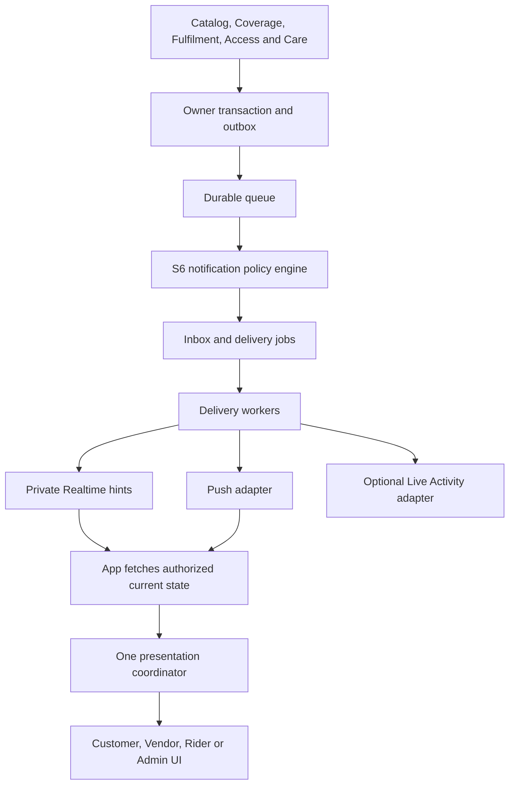

# Toade3 Notification Architecture and AI Implementation Prompt

Version 1.0.0 draft | 20 October 2026

## 1. Product contract and boundaries

This specification extends Toade3's S6 Messaging boundary. It covers the installed Customer, Vendor and Rider apps plus the protected Admin platform. Supabase remains the shared data platform with private domain-owned schemas. The app's actual framework/version must be inspected before code changes; React Native + Expo/TypeScript is the previous proposed default.

Every meaningful activity needs appropriate feedback. Only a subset deserves an interruptive notification. Core order milestones, unresolved operational actions, exceptions and verified account/support events take priority. Routine browsing and form interactions remain local. Notification policy kinds below are presentation rules; they do not claim that every listed source event or capability already exists.

The existing order state machine, one-vendor cart, durable checkout attempt recovery, rider claim/batch limits and protected one-time handover remain authoritative. Notifications cannot mark an order accepted, a rider assigned or a delivery completed. Payment/refund, arrival/proximity, review and item-watch rules are explicitly conditional.

The earlier capsule image is the visual reference for a custom in-app component. It is not a complete notification service, an OS permission, a background-execution mechanism or a native Live Activity implementation.

## 2. Presentation surfaces and priority

| Surface | Purpose | Behavior |
| --- | --- | --- |
| Persistent order capsule | Current active order | Lives while the order is active; latest authorized state, action and optional fresh ETA. Multiple orders have a selector rather than overlapping cards. |
| Transient banner | Meaningful change or exception | One at a time; proposed P1 duration 6 seconds, P2 3 seconds; accessibility may extend the duration. Important information remains in the task/inbox. |
| Action-required task card | Pending Vendor/Rider/operational task | Remains discoverable until the business owner resolves the task. Banner dismissal is not acceptance or acknowledgement. |
| Inline feedback / confirmation sheet | Field errors, cart changes, connection state, destructive confirmation | Use near the affected control. Confirm another-vendor cart replacement before mutation; never silently clear the old cart. |
| Notification inbox | Durable user-readable history | Role-scoped, grouped by order/case and date; read/unread is independent of business action. Obsolete actions open the current state safely. |
| OS push | Background/closed-app alert | Platform-owned appearance, permission and delivery behavior. Generic privacy-safe copy with an opaque notification ID. |
| Optional Live Activity / ongoing native status | Glanceable active-delivery status | Separate platform adapter, lifecycle and registration. Start/update/end using canonical owner state and end on terminal/revocation conditions. |

| Tier | Meaning | Default policy |
| --- | --- | --- |
| P0 | Action required or urgent exception | Expose promptly in the app/task board; eligible background push and owner-driven escalation. This does not mean Apple Critical Alerts or an exemption from Do Not Disturb. |
| P1 | Important order/service milestone | Update the persistent capsule; one context-aware banner or push, plus inbox when the matrix specifies. |
| P2 | Ordinary information/feedback | Quiet component/inline update; no push by default. Avoid repeating a success already shown for the actor's own command. |
| P3 | Marketing or optional subscription | Separate consent and frequency caps; respect quiet hours; never preempt unresolved P0/P1 work. |

## 3. Capsule design and live component states

Use a reusable component, not the exported PNG as interactive UI.

| Token / property | Proposed design |
| --- | --- |
| Typeface | Manrope; 16-point semibold title, 13-point secondary text, 13-point action text; scale for accessibility. |
| Colors | Body #090909; primary #FFFFFF; secondary #BDBDBD; action #30302E; progress #FCB501; neutral track #30302E. |
| Geometry | Full available width minus 16-point margins; approximately 88-point height at normal text sizes, increasing when needed. Capsule radius derived from height. |
| Leading icon | 40-point circular brand/icon region; use real Toade3 assets and a status glyph. Avoid using color as the only status cue. |
| Action | At least 48 x 48-point interactive area; visual pill can be smaller with non-overlapping hit regions. Use View order, Track order, Review order or View jobs according to the policy. |
| Progress path | SVG/native rounded capsule track with 2-3-point inset stroke and rounded ends. Recalculate path geometry on width/height changes; animate the stroke on the UI thread. |
| Placement | Below the top safe area. Persistent state has a stable layout slot; transient overlays must not cover critical navigation or modal actions. Surrounding overlay regions pass touches to the screen. |
| Motion | Proposed 220-300 ms restrained entrance/transition, no repeated bouncing. Reduce Motion removes springs; support larger text, screen readers and focus-safe announcements. |

State model: loading, active, action_required, delayed, unavailable_timing, stale, completed, cancelled, rejected and dismissed_banner. A dismissed banner can still have an active task or unread inbox record.

For the ordinary order outline use six discrete phases: Placed, Accepted, Preparing, Ready, On the way, Delivered. A display mapping of 0/20/40/60/80/100 is a phase indicator, not an estimate of physical journey completion. Readiness refers to kitchen readiness, not the customer's instruction to collect. Rider assignment is parallel information, not a replacement order phase. Cancellation/rejection use exception styling and no completed ring.

Only the verified Fulfilment handover transition produces Delivered. Never let a countdown reaching zero change the order state. ETA uses a server-computed estimate plus its timestamp/expiry; if unavailable or stale use Preparing your meal / Checking the latest timing. Do not fabricate Ready in 5 min. Expired timing must be refreshed, not kept alive by an animation.

Use one foreground presentation coordinator per app instance. If the active order capsule already explains the same milestone, update it without a second toast. An important exception may temporarily take the presentation slot. Keep at most three pending transient notices; coalesce lower-priority same-order updates and never drop unresolved business tasks from their board.

When a native modal is open, use a coordinated modal-layer host or defer nonurgent banners. Do not create independent competing listeners/hosts. Nonurgent notices must not steal keyboard/screen-reader focus. Provide an accessible dismiss control where dismissal is allowed; preserve a persistent task entry after dismissal.

## 4. Customer activity matrix

| ID / activity | Priority / surface | Push / inbox | Sample title / CTA | Source / gate |
| --- | --- | --- | --- | --- |
| C01 Order committed | P1; Active-order capsule | Background; inbox Yes | Order placed / View order | S5 order.created; Core |
| C02 Vendor accepts | P1; Active-order capsule | Background; inbox Yes | Your order is accepted / View order | S5 order.status_changed: accepted; Core |
| C03 Preparation begins | P2; Quiet capsule update | No; inbox No | Your meal is being prepared / View order | S5 order.status_changed: preparing; Core |
| C04 Food ready | P1; Capsule update | Background; inbox Yes | Your meal is ready / View order | S5 order.status_changed: ready; Core |
| C05 Rider assigned | P2; Quiet capsule update | No; inbox No | A rider is assigned / View order | S5 order.assignment_changed; Core |
| C06 Picked up / on the way | P1; Capsule update | Background; inbox Yes | Your order is on its way / Track order | S5 delivery.status_changed + order.status_changed: out_for_delivery; Core |
| C07 Rider nearby | P1; Transient banner + capsule | Background; inbox No | Your rider is nearby / Track order | S5 validated proximity milestone - proposed; Validated proximity capability |
| C08 Rider arrived | P0; Action capsule | Background; inbox Yes | Your rider has arrived / View order | S5 explicit arrival milestone - proposed; Explicit arrival capability |
| C09 Verified delivery | P1; Completion banner | Background; inbox Yes | Your order is delivered / View order | S5 delivery.status_changed: delivered; Core |
| C10 Vendor rejects | P0; Exception banner | Background; inbox Yes | Your order could not be accepted / View order | S5 order.status_changed: rejected; Core |
| C11 Order cancelled | P1; Exception banner | Background; inbox Yes | Your order is cancelled / View order | S5 order.status_changed: cancelled; Core |
| C12 Material delivery delay | P1; Exception capsule | Background; inbox Yes | Your order is taking longer / View order | S5 explicit delay assessment - proposed; Server delay assessment |
| C13 Cart price/stock/coverage changes | P0; Inline review card | No; inbox No | Your cart needs a quick review / Review cart | S5 current quote/cart validation; Core |
| C14 Verified payment failure | P0; Inline payment recovery + banner | Background; inbox Yes | Your payment needs attention / View payment | S8 verified payment state - future; Payments enabled |
| C15 Refund changes | P1; Inbox + banner | Background; inbox Yes | Your refund has an update / View refund | S8 verified refund state - future; Payments enabled |
| C16 Review request | P2; Inbox only | No; inbox Yes | How was your order? / Rate order | S7 delivered-order review workflow - optional; Reviews enabled |

Customer-ready copy says the meal is ready for the rider, not that the customer must pick it up. Nearby requires a validated fresh proximity capability; arrival requires an explicit owner-recorded arrival milestone. These do not silently extend the legal delivery state machine. Order cancellation/rejection does not imply a completed refund. Payment rows stay disabled until S8 is implemented.

## 5. Vendor activity matrix

| ID / activity | Priority / surface | Push / inbox | Sample title / CTA | Source / gate |
| --- | --- | --- | --- | --- |
| V01 New own-business order | P0; Kitchen task card + banner | Background; inbox Yes | New order needs your response / Review order | S5 order.created; Core |
| V02 Unresolved response deadline | P0; Persistent kitchen task | Conditional; inbox Yes | This order still needs a response / Review order | S5 pending-task deadline - proposed; Owner deadline configured |
| V03 Own order cancelled | P0; Board update + banner | Background; inbox Yes | Order {order_reference} is cancelled / View order | S5 order.status_changed: cancelled; Core |
| V04 Rider assigned | P2; Quiet kitchen card update | No; inbox No | A rider is assigned / View order | S5 order.assignment_changed; Core |
| V05 Assigned rider at pickup | P0; Kitchen task card | Background; inbox Yes | Your rider is at pickup / View pickup | S5 explicit pickup-arrival milestone - proposed; Explicit pickup-arrival capability |
| V06 Order collected | P2; Quiet kitchen card update | No; inbox No | Order collected / View order | S5 delivery.status_changed: picked_up; Core |
| V07 Low-stock threshold crossed | P2; Menu badge + inbox | No; inbox Yes | An item is running low / Review stock | S2 inventory threshold - proposed; Low-stock thresholds configured |
| V08 Intake paused or disabled | P0; Persistent intake warning | Background; inbox Yes | Your store is not accepting orders / Review store | S2 vendor.opening_changed; Core |
| V09 Approval decision | P1; Account banner + inbox | Background; inbox Yes | Your vendor account has an update / View account | S1 capability decision - proposed; Vendor approval capability |

A new kitchen order is acknowledged only by the owning S5 accept/reject transition or other owner resolution. The prior proposed 20-second foreground repeat chime may be retained only while a current pending ticket exists and configured limits allow it. Stop on resolution, sign-out, access loss or foreground exit. Do not issue background push/sound every 20 seconds. At most an initial alert plus an owner-approved reminder is the proposed push default; actual deadlines come from S5, not notification copy.

## 6. Rider activity matrix

| ID / activity | Priority / surface | Push / inbox | Sample title / CTA | Source / gate |
| --- | --- | --- | --- | --- |
| R01 New eligible jobs | P1; Job-feed prompt | Conditional; inbox No | New delivery jobs are available / View jobs | S5 limited eligible-feed invalidation; Core |
| R02 Own claim succeeds | P2; Local task-card update | No; inbox No | Delivery added to your jobs / View job | S5 committed claim response; Core |
| R03 Assigned order ready | P0; Persistent pickup task | Background; inbox Yes | Your pickup is ready / View pickup | S5 order.status_changed: ready; Core |
| R04 Assignment withdrawn/cancelled | P0; Task removal + banner | Background; inbox Yes | Your delivery assignment changed / View jobs | S5 order.assignment_changed / cancelled; Core |
| R05 Handover verification required | P0; Job detail task | No; inbox No | Confirm the handover / Verify handover | S5 current picked-up job / handover workflow; Core |
| R06 Delivery completes | P2; Local success + job refresh | No; inbox No | Delivery completed / View jobs | S5 verified completion response; Core |
| R07 Claim capacity/race failure | P1; Inline job feedback | No; inbox No | This job cannot be added / Refresh jobs | S5 claim validation; Core |

A job-offer notification does not assign a job. It opens the eligible feed; claiming is a fresh authenticated S5 command subject to races and capacity. Notify Food ready only for the assigned rider. A withdrawn assignment opens View jobs and purges old contacts/proofs; it must not deep-link into now-forbidden customer details. Handover copy never contains the actual code. Rider telemetry updates do not generate individual customer popups.

## 7. Admin activity matrix

| ID / activity | Priority / surface | Push / inbox | Sample title / CTA | Source / gate |
| --- | --- | --- | --- | --- |
| A01 Order needs operational response | P0; Incident dashboard | On-call only; inbox Yes | An order needs attention / Review incident | S5 owner incident/deadline assessment; Operational thresholds configured |
| A02 Delivery needs intervention | P0; Incident dashboard | On-call only; inbox Yes | A delivery needs attention / Review incident | S5 explicit incident assessment; Operational thresholds configured |
| A03 Notification pipeline failing | P0; Monitoring/dashboard | Independent channel; inbox Yes | Notification delivery is degraded / Open operations | Independent monitoring; Independent monitoring configured |
| A04 Coverage publication/service stop issue | P0; Operations dashboard | On-call only; inbox Yes | Delivery coverage needs attention / Review coverage | S3 policy operation + monitoring; Core |
| A05 Approvals awaiting review | P2; Dashboard badge/digest | No; inbox Yes | Applications are waiting for review / Review applications | S1 approval queue; Approval workflow enabled |
| A06 Verified security incident | P0; Restricted security dashboard | On-call only; inbox Yes | A security event needs review / Review security | S1 / security incident owner; Verified security-event capability |
| A07 Payment/reconciliation incident | P0; Finance incident dashboard | On-call only; inbox Yes | A payment needs review / Review payment | S8 reconciliation assessment - future; Payments enabled |

Send alerts to the responsible staff/on-call audience, not every administrator. An outage in S6 must be detected by independent monitoring rather than relying exclusively on the broken S6 queue/push path. Operational thresholds and escalation targets require an implemented owner policy; do not create hidden auto-cancellation or reassignment rules.

## 8. Shared, local and marketing activity matrix

| ID / activity | Priority / surface | Push / inbox | Sample title / CTA | Source / gate |
| --- | --- | --- | --- | --- |
| S01 Support reply | P1; Banner + inbox | Background; inbox Yes | Support has replied / View support | S7 support.ticket_changed; Core |
| S02 Account access changes | P0; Access gate / account message | Conditional; inbox Yes | Your account needs attention / View account | S1 current account/capability result; Core |
| S03 Push permission decision | P2; Inline preference feedback | No; inbox No | Choose how Toade3 updates you / Notification settings | Local permission flow; Core |
| S04 Email code requested | P2; Auth screen feedback | No; inbox No | Check your email / Enter code | Managed Auth email OTP flow; Core |
| L01 Item added | P2; Local snackbar or cart badge | No; inbox No | Added to your cart / View cart | S5 confirmed cart response; Core |
| L02 Different-vendor item selected | P2; Confirmation sheet | No; inbox No | Start a new cart? / Review new cart | Local confirmation before S5 cart replacement; Core |
| L03 Validation error | P2; Inline field error | No; inbox No | Check the highlighted details / Focus field | Local/API field validation; Core |
| L04 Connection lost | P1; Persistent connectivity strip | No; inbox No | You are offline / Try again | Local connectivity + failed reads; Core |
| L05 Unknown placement outcome | P0; Persistent recovery card | No; inbox No | We are checking your order / Check order status | S5 durable attempt recovery; Core |
| L06 Search/filter changes | P2; Inline count/selection feedback | No; inbox No | Results updated / None | S4 response / local draft; Core |
| L07 Support send fails | P1; Inline pending/failed message | No; inbox No | Your message has not been confirmed / Check message | S7 command result or unknown result; Core |
| M01 Relevant offer | P3; Inbox; optional banner | Opt-in only; inbox Yes | An offer is available near you / View offer | S4 eligible campaign policy; Marketing consent + valid campaign |
| M02 Watched item back in stock | P3; Inbox; optional banner | Opt-in only; inbox Yes | An item you saved is available / View item | S2 change + subscription policy - future; Item-watch feature + consent |

Routine local effects have no push/inbox side effect. Support replies are scoped to the owning case. Account access gates remain usable even when business capabilities are removed. Default operational preferences are distinct from optional marketing consent. Proposed marketing cap: at most one promotional push per user per day, rechecked before sending; this is a configurable product default, not a provider guarantee.

## 9. Backend delivery architecture



Domain owner flow:

1. Catalog, Coverage, Access, Fulfilment or Care validates the command and commits the domain change plus an outbox event in the same local transaction.
2. A relay publishes committed events to the selected durable transport. Keep the existing SNS/SQS adapter if implemented; for a new Supabase-first pilot, Supabase Queues is a documented alternative. Select one deployment transport and record the decision before implementation. Private Realtime is not the durable queue. [R1]
3. S6 consumes with an idempotency key. In one S6 transaction, persist consumer_inbox, authorized notification recipients, user inbox records and delivery jobs. No cross-service table joins or writes.
4. Leased delivery workers recheck the user's current access, the resource's current owner state, eligibility, preferences and expiry. Suppress obsolete/superseded work before provider submission. Worker lease duration/renewal must cover provider request timeouts.
5. Adapters deliver private foreground hints, OS push and optional native live-status updates. Classify temporary failures, permanent failures, unknown submission outcomes and expired work separately.
6. Clients receive opaque hints, fetch authorized canonical state, then update the appropriate UI through one coordinator. Inbox and task-board reads recover missed alerts.

Treat delivery as at least once. Server uniqueness plus client deduplication prevents repeated app presentations; OS/provider duplication cannot be perfectly eliminated after an unknown submission outcome. Use provider collapse/replacement features where supported, but do not make correctness depend on them. A successful push submission is not device delivery or proof that a person read it. [R2]

The owner remains the source of business truth during S6/provider outages. Orders, cart reservations, rider assignments and proof verification cannot depend on a notification succeeding. Scheduled reminders query/revalidate the current owner task before every escalation; a read receipt or dismissed banner does not resolve that task.

Delivery receipts and notification.delivery_recorded are operational telemetry. Do not feed those events back into a user-facing notification policy and create a notification loop.

## 10. Supabase data, ownership and API contracts

| Private messaging entity | Important fields / invariant |
| --- | --- |
| consumer_inbox | producer + event_id unique; committed processing result. Compare source resource versions only within the same resource type/ID. |
| notifications | notification_id, kind, source resource reference/version, dedup_key, template/policy versions, priority, occurred_at, expires_at, superseded_at. |
| notification_recipients | notification_id, recipient_user_id, app_kind, tenant/business scope, read_at/dismissed_at. Unique logical recipient policy; users cannot change ownership/body/priority. |
| delivery_jobs / attempts | recipient notification + installation + channel unique job; attempt_no, lease, not_before, provider ticket/receipt, state and last_error_class. |
| device_installations / push_registrations | installation ID, actual app/environment/project, user association, provider token encrypted at rest, permission status, active flag, refresh/expiry timestamps. |
| notification_preferences | User-owned app/category settings, marketing consent/revision, quiet hours/timezone, permitted sound/haptic choices. Preferences cannot grant another role. |
| policy_versions / templates | Server-controlled kind-to-audience/surface/priority/expiry mapping with supported variables and allowlisted route intents. No remote executable UI code. |
| scheduled_alerts / escalation_records | Owner resource/deadline reference, state guard, next check and idempotent escalation stage. Resolved source work cancels pending reminders. |
| live_activity_registrations - optional | User/app/order/activity association, platform-specific activity token, lifecycle, stale date and revoke/end state; distinct from ordinary push tokens. |

Keep domain schemas private. For intentionally exposed tables, explicit grants and tested row policies are both required. Push tokens, provider credentials, job payloads and internal audit records are never broadly exposed. Use restricted server identities and publishable client keys. Never derive authorization from editable user_metadata. Current account/tenant/role checks apply even when a JWT still contains older claims. [R3]

Preserve the existing Customer API routes:

| Route | Contract |
| --- | --- |
| POST /v1/customer/devices | Register/refresh this authenticated installation. Server derives user ID and validates app/project/environment; never trust an arbitrary recipient ID. |
| DELETE /v1/customer/devices/{installation_id} | Detach only the caller's installation association; revoke jobs/activity registration as appropriate. |
| GET /v1/customer/notifications | Cursor-paged own-app inbox with explicit read status, safe copy, source reference and allowlisted intent. |
| POST /v1/customer/notifications/{notification_id}/read | Idempotently mark the caller's recipient row read; this does not acknowledge an order/job. |
| GET / PATCH /v1/customer/notification-preferences | Own preference snapshot / versioned patch with conflict handling and category allowlist. |
| POST /v1/customer/realtime-authorizations | Issue short-lived channel access after current resource and app-audience authorization. |
| Vendor / Rider / Admin adapters | Use the same S6 engine through their scoped API namespaces and schemas; route names must be reconciled with each actual repository. |

Proposed additive APIs may record a presentation/dismissal acknowledgement, but business acknowledgements terminate in S5/S2/S1 as appropriate. Keep endpoint/DTO compatibility with installed builds. Notification actions validate ownership again rather than exposing arbitrary target URLs.

## 11. Event, notification and push envelopes

Use the existing minimal domain event contract. Add compatible notification contracts instead of pretending all notification kinds are new domain event names.

Example owner event (illustrative IDs):

```json
{
  "event_id": "01900000-0000-7000-8000-000000000901",
  "schema_version": 1,
  "event_type": "order.status_changed",
  "producer": "order-fulfilment",
  "resource_type": "order",
  "resource_id": "01900000-0000-7000-8000-000000000902",
  "resource_version": 12,
  "order_id": "01900000-0000-7000-8000-000000000902",
  "occurred_at": "2026-10-20T19:40:00Z",
  "correlation_id": "checkout-trace-example",
  "data": {
    "status": "ready"
  }
}
```

Example server notification record:

```json
{
  "notification_id": "01900000-0000-7000-8000-000000000903",
  "kind": "customer.order.ready",
  "recipient_user_id": "01900000-0000-7000-8000-000000000904",
  "app_kind": "customer",
  "priority": "P1",
  "resource_type": "order",
  "resource_id": "01900000-0000-7000-8000-000000000902",
  "resource_version": 12,
  "dedup_key": "order:example-id:12:ready:recipient:customer",
  "policy_version": 1,
  "template_version": 1,
  "title": "Your meal is ready",
  "body": "It is ready for your rider to collect.",
  "action": {
    "intent": "order.details"
  },
  "expires_at": "2026-10-20T20:00:00Z"
}
```

Example privacy-safe push data:

```json
{
  "title": "Toade3 update",
  "body": "Open the app to view your latest update.",
  "data": {
    "schema_version": 1,
    "notification_id": "01900000-0000-7000-8000-000000000903",
    "app_kind": "customer"
  }
}
```

The shown expiry is an example, not an approved operational TTL. Define expiry per policy against source state. Distinguish banner_visible_ms, push TTL, notification semantic expiry, owner action_deadline_at and inbox retention. Historical inbox entries may remain after their action becomes obsolete; tapping opens current authorized state.

Do not compare order version 12 with delivery version 7. They are different resource counters. Keep per-resource version tracking, detect gaps and fetch the owner aggregate. Only a separately defined owner aggregate revision may serve as a unified counter. Discard obsolete foreground responses using request/context/session identity as well as versions.

## 12. Foreground, background and native activity lifecycle

Foreground behavior:

- Register the notification receive/response handlers once at app level, plus a single lifecycle-aware Realtime subscription manager. Clean them up on unmount/sign-out/account switch. Expo provides receive and response listeners; the client still needs its own policy/deduplication coordinator. [R4]
- Subscribe and buffer authorized hints, fetch current owner snapshot, then process only relevant newer hints. Reconnect, resume and notification taps repeat authorization and snapshot reconciliation.
- Suppress the ordinary OS foreground alert when the app has already chosen custom presentation, where the platform API supports that behavior. Prefer Realtime for the active screen but tolerate push arriving as well. Both resolve the same logical notification/resource update.
- If the person is already viewing the relevant order/task, update that screen/capsule instead of showing another identical banner. Suppress redundant success popups for the same person's own confirmed command/correlation ID.
- Permission denial does not remove in-app status, inbox or task-board functionality.

Background/closed behavior:

- Use OS push for eligible milestones. Do not assume JavaScript, a websocket or a background timer continues running or renders a custom capsule when the app is closed.
- On a cold-start tap: bootstrap secure session, validate the opaque notification recipient and current role/resource access, then navigate to an allowlisted route. If signed out, hold only a bounded safe intent through authentication. If access was removed, show a safe account/jobs/orders entry rather than exposing an old record.
- Clear the processed initial notification response so it is not replayed on every render/restart. Do not interpret tap/read as confirmation of order acceptance, pickup or delivery.

Optional native status:

- iOS Live Activities use native ActivityKit with a WidgetKit/SwiftUI extension and their own lifecycle; server updates can use APNs activity tokens. This is a separate integration, not the ordinary Expo token or a PNG banner. End/update it for completion, cancellation, rejection and access changes. Hide sensitive delivery details in lock-screen contexts. [R5]
- Android notification appearance, importance and runtime permission are system-governed; channel configuration and permission education must fit the supported SDK/OS. Do not assume an iOS capsule can be forced onto Android's system notification UI. [R6]
- A denied native activity/push permission falls back to in-app status plus inbox. Do not repeatedly prompt after denial; offer a settings route when the user asks.

## 13. Reliable delivery, expiry and escalation

Deduplicate at three boundaries: source event ingestion, logical recipient notification and per-installation channel job. A recommended logical key includes source producer/resource type/resource ID/version, notification kind, recipient and app audience. Database uniqueness prevents duplicate inbox effects; attempt records are separate so a retry does not create another logical notification.

Workers are lease-based and concurrency-bounded. Commit delivery intent before calling a provider. On retry, check current state and semantic expiry first. Retry temporary network/rate/server failures with bounded exponential backoff and jitter. Stop expired work and permanent errors; dead-letter poison messages with an alarm. A provider timeout can leave an unknown submission outcome, so external duplicates remain possible. Reprocess through the same idempotency gates.

When using Expo, track push tickets and receipts separately. A ticket confirms submission to Expo; a receipt confirms handoff to APNs/FCM, not that a device displayed it. Disable invalid tokens on DeviceNotRegistered and reconcile receipts on the documented schedule. Do not retry malformed payloads, invalid credentials or oversized bodies forever; route credential/configuration faults to operations. [R2]

Keep these four dimensions separate:

| Dimension | Evidence | Does not mean |
| --- | --- | --- |
| Transport | Queued, provider accepted, provider confirmed handoff, failed or expired | A human received or read it. |
| Presentation | Optional client display acknowledgement | The task was accepted. |
| Inbox read | User marked/opened their own recipient record | A kitchen accepted, rider claimed or delivery completed. |
| Business resolution | Current owner state changed through authorized command | Every notification device was reached. |

Escalation timers belong to actual pending work. Before each reminder, verify ownership, assignment, state and the owner deadline. Resolve/cancel reminders when work ends or changes assignee. Store escalation stage idempotently. Do not create auto-cancel, refund or forced reassignment rules inside S6.

User preferences and OS controls remain in effect. P0 is a product priority, not permission to bypass quiet settings or use critical-alert entitlements. Working-shift Vendor/Rider alerts may follow agreed operational preferences; marketing obeys separate consent and quiet hours. No automatic SMS/WhatsApp/call fallback is activated by this specification.

Keep metrics for source-to-inbox latency, queue age, dispatch attempts, provider errors, unknown outcomes, stale/suppressed messages, dedupe rate, opened/read events and business acknowledgement latency. Count missing receipts separately from delivery failures. The existing foreground Vendor-acceptance-to-Customer-render p95 <500 ms target over 200 trials (none >1 s) remains a test target; it is not a push SLA. Monitor pipeline health independently of the pipeline.

## 14. Privacy, preferences and device associations

Bind each installation to app kind, build environment/project and authenticated user association. A Customer app and Vendor app on the same physical phone remain separate installations/audiences. Tokens are not business roles. Refresh rotated tokens, disable invalid registrations and expire inactive ones according to a documented retention policy.

On account switch or sign-out, detach the old association, stop relevant subscriptions, cancel known old-user notifications, end/revoke registered live activities and clear per-user cached content. Do not erase a native device token globally if another valid association uses it; update association scope. A push already in flight can arrive after sign-out, which is why its preview must remain generic and its tap reauthorizes.

Group preferences into order updates, work/job alerts where applicable, support, account/security and optional offers. Inbox/task access remains even when push is disabled. Ask for notification permission at a meaningful point with clear benefit, rather than adding an unexplained mandatory prompt before browsing. Android runtime permission requirements must be checked against the real target SDK. [R6]

Keep OTPs in the managed email-auth flow and delivery PIN/QR secrets in their protected handover flow. Never put these values, exact customer addresses, phone numbers, raw rider coordinates, internal commissions or provider secrets into lock-screen push, public topics or default analytics. Use private authorized Realtime channels with tested rules; do not broadcast full protected rows. Authorization at a cached channel join is not a substitute for current owner authorization on the subsequent read. [R3]

Backend token/provider access is restricted to the delivery worker. RLS/grants protect deliberately exposed resources; private schemas and APIs enforce domain ownership. Staff actions and policy/template edits require granular permission and audit evidence. Do not rely on stale JWT roles or editable user metadata. Logs retain correlation/resource references and coarse outcomes without sensitive bodies.

## 15. Module organization and implementation plan

Proposed organization; adapt to the actual repository:

```text
apps/customer/src/shared/notifications/
  NotificationProvider
  PresentationCoordinator
  OrderStatusCapsule
  ActionRequiredBanner
  NotificationInbox
  NotificationPreferences
  notificationRouting
  foregroundPolicy
  platformAdapters

services/messaging/
  domain/{policies,templates,recipients,expiry}
  application/{consumeEvent,buildNotification,resolveAudience}
  workers/{dispatch,reconcileReceipts,escalate,cleanup}
  adapters/{durableQueue,realtime,push,liveActivity}
  api/{inbox,preferences,installations,authorizations}
  persistence/{migrations,restrictedRepositories}
  observability/{metrics,independentHealthChecks}
```

Vendor/Rider/Admin reuse shared presentation primitives and contracts, with audience-specific policy/routes rather than a second independent engine per app. NotificationsInbox and active-order/task state have different data lifecycles; do not build current order truth from old inbox copy.

Build order:

1. Reconcile existing owner events, role/current-state checks, installed app stack and existing S6 routes.
2. Implement the policy registry, templates, scoped inbox/device/preferences model and idempotent owner-outbox/consumer contract.
3. Connect the selected durable queue and workers with expiry, dedupe, receipts and independent health metrics.
4. Implement the presentation coordinator and capsule/task/inline/inbox components; wire foreground subscriptions and canonical snapshot recovery.
5. Implement background tap routing, permissions, token lifecycle and optional native activity adapter behind a capability flag.
6. Exercise important Customer/Vendor/Rider/Admin journeys, outage/replay cases, permission/access changes, accessibility and real-device release gates.

All thresholds, banner durations and native capability choices are proposed defaults until measured and approved in the actual implementation. No deployment, mobile source or live Supabase schema was changed while producing this specification.

## 16. Acceptance and release evidence

Require the following in the actual application:

- One committed order creates one logical user milestone and one kitchen task under duplicate/replayed events.
- Accepted/preparing/ready/pickup/delivered and rejection/cancellation use authorized current states, not arriving push order or elapsed time.
- A delayed ready event after pickup/completion is suppressed; per-resource version counters are never compared across resource types.
- The same foreground update arriving through push and Realtime produces one chosen presentation; the current detail screen does not get a duplicate banner.
- Vendor dismissal/read does not stop an unresolved task timer. Actual accept/reject/cancel stops it. Reminder after a completed task is suppressed.
- Two riders claiming a job cannot be made assigned by a notification tap; the owner command settles the race and capacity rules.
- Withdrawn assignments remove old access, contacts and live activity state; View jobs is safe after permission loss.
- Queue crash after S6 commit, provider timeout, duplicate receipt and dead-letter replay do not create duplicate inbox records or business commands.
- Sign-out, account switch, token rotation, removed business membership, disabled permission and cold-start tap do not expose old-user records.
- Denied push or provider outage leaves current in-app status/inbox/task board usable. Cached status is labeled stale and refetched.
- Payment/refund, review, proximity/arrival and marketing controls remain disabled without their actual capability/consent/source contracts.
- Screen readers, small widths, larger text, reduced motion, keyboard/modal layers and the last tappable feed card work with the banner host.
- Physical iOS/Android tests verify foreground, background, locked-device and terminated/cold-start behavior; mock delivery is not proof of OS delivery.
- Measure ordering-to-alert, transport handoff and business acknowledgement separately. Retain device/build/network/backend revisions for release evidence.

These are implementation acceptance requirements, not claims that these tests passed against a live Toade3 application.

## 17. Copy-ready AI implementation prompt

Act as the senior mobile and backend engineer for Toade3. Implement a shared, event-driven notification system for the Customer, Vendor, Rider and Admin applications using the actual project stack and existing Supabase platform.

1. Inspect the repository first. Identify navigation, app entry points, existing notification handlers, Supabase schemas/migrations, auth, role/membership rules, domain events, workers, tests and installed package versions. Reuse existing architecture and dependencies where compatible.

2. Build a central NotificationProvider and presentation coordinator, with reusable OrderStatusCapsule, ActionRequiredBanner, InlineFeedback, NotificationsInbox and NotificationPreferences components. Use Manrope, a near-black capsule, white primary text, muted secondary text, a charcoal action pill and Toade3 yellow #FCB501 for the stage outline. Use the actual brand icon. Render live text and an SVG/native progress path rather than a flattened image. Support small screens, safe areas, large text, screen readers and reduced motion.

3. Implement P0 action-required/urgent, P1 order milestones, P2 ordinary feedback and P3 opt-in marketing policies. Routine search, filtering, quantity changes and form errors use inline feedback, not push alerts. Keep one transient banner visible at a time. Coalesce updates for the same order, suppress obsolete messages and keep marketing behind unresolved operational work. Dismissal must not acknowledge a business task.

4. Maintain one persistent capsule per active order, with an accessible selector when multiple orders exist. Drive phase and ETA from authorized canonical order data. Use the six-stage display model Placed, Accepted, Preparing, Ready, On the way and Delivered; only verified handover marks Delivered. Treat the outline as a phase indicator. Missing/stale timing shows an honest status, not a fabricated countdown. Rejection/cancellation use exception styling, not a completed progress ring.

5. Cover all important policies in this specification: committed placement, acceptance, readiness, pickup, verified completion, rejection, cancellation, delays, cart revalidation, support replies, Vendor pending work, assigned Rider pickup tasks, withdrawn assignments and Admin incidents. Enable nearby/arrival alerts only after their validated owner events exist. Payment/refund alerts, item watches and review requests remain capability-gated until those features are implemented.

6. Use owner transactions and outboxes, a durable queue and an idempotent S6 consumer. In one S6 transaction write consumer deduplication, recipient notification and delivery jobs. Workers recheck authorization, current owner state, expiry and preferences immediately before sending. Do not directly join another service's schema. Keep order/delivery/claim/proof transitions in Fulfilment; notification delivery cannot authorize them.

7. Separate in-app presentation, private Supabase Realtime hints, durable inbox, OS push and optional native Live Activities. In-app custom UI is for the foreground app. System notifications have platform-controlled presentation. Native iOS Live Activities require their own ActivityKit/WidgetKit integration and tokens; do not assume the capsule or ordinary Expo push implements them. Retain the existing durable transport if already deployed; select and document the transport adapter if starting fresh.

8. Implement installation registration, token rotation, app/environment/user association and sign-out cleanup. Use publishable keys in clients, never privileged secrets. Protect private data and channels with role/tenant ownership and current-session checks. Push previews are generic. Never include OTPs, PINs, QR secrets, exact addresses, contact details or raw rider coordinates in notification payloads.

9. Register app-level handlers once and clean them up. Reconcile subscriptions plus snapshots on resume/reconnect. Deduplicate foreground push and Realtime for the same logical update. Before navigating from any notification, validate the session, notification ownership, app audience, current resource permission and allowlisted route. Recover authentication before continuing a safe destination. Do not trust a caller-supplied URL.

10. Implement bounded retries with jitter, permanent-token failure handling, provider ticket/receipt reconciliation, semantic expiry and monitored dead-letter recovery. A provider receipt, a displayed banner, a read message and a completed business action are separate facts. Push is best effort. Deadline reminders must recheck actual pending work and stop when the owner resolves it. An independent monitor must detect a broken notification pipeline.

11. Provide grouped notification preferences, permission education at a relevant point, Android channel handling, quiet-hour policies and marketing consent. Respect OS sound/permission choices. Vendor foreground reminders may use the configured kitchen cadence only while canonical work remains pending; do not loop background push or sound every few seconds.

12. Verify duplicate/out-of-order events, stale milestones, multiple devices, account switching, denied permissions, cold-start taps, changed roles, cancelled/reassigned jobs, worker crashes, invalid tokens, provider outages, accessible layout and smooth scrolling. Run the actual project's relevant type/lint/contract/integration checks. Document physical-device and production checks that remain unavailable.

Deliver code and reviewed migrations where the repository supports implementation, the policy registry, templates, API/event contracts, tests and operational runbooks. Report changed files, compatibility notes, checks actually run and remaining release gates. Use synthetic test recipients; do not send to real customers as part of verification. If a required owner event or capability does not exist, complete independent work and identify that specific dependency rather than inventing a successful integration.

## 18. Primary references and review status

Primary sources checked 20 October 2026:

- [R1 Supabase Queues](https://supabase.com/docs/guides/queues): durable Postgres-native queue option. Queue processing guarantees do not imply guaranteed device delivery.
- [R2 Expo sending notifications](https://docs.expo.dev/push-notifications/sending-notifications/): provider tickets/receipts, invalid-token handling, limits and best-effort transport.
- [R3 Supabase Realtime authorization](https://supabase.com/docs/guides/realtime/authorization): private channel controls and row-policy integration. Also verify [API security](https://supabase.com/docs/guides/api/securing-your-api) and [RLS](https://supabase.com/docs/guides/database/postgres/row-level-security) for the actual project.
- [R4 Expo incoming notification handling](https://docs.expo.dev/push-notifications/receiving-notifications/): receive/response listeners and foreground/background interaction flow.
- [R5 Apple Live Activities](https://developer.apple.com/documentation/activitykit/displaying-live-data-with-live-activities): separate native ActivityKit/WidgetKit lifecycle and APNs integration.
- [R6 Android notification permission](https://developer.android.com/develop/ui/compose/notifications/notification-permission): supported Android runtime permission requirements. See also [Android notifications](https://developer.android.com/develop/ui/views/notifications).

Version 1.0.0 engineering draft. The existing S6 Messaging and cross-app connector documentation is the domain baseline; this specification adds detailed presentation/delivery policies. Local checks verified policy-ID uniqueness, priority/surface coverage, parseable example JSON and required safety/correctness topics. No backend, RLS, provider, device, load or production integration tests were run for this document.
